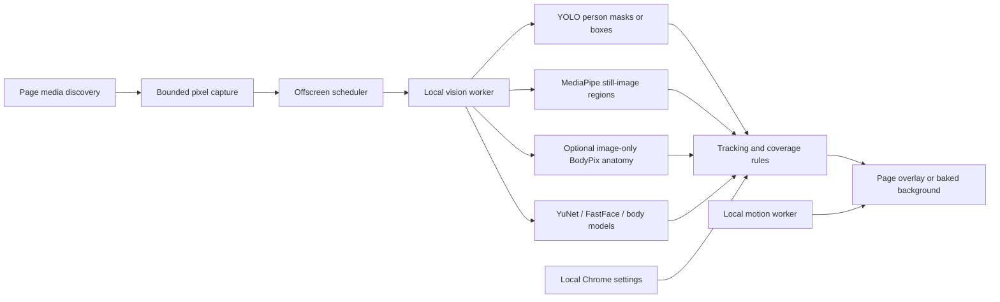

# Architecture

Sitr is a Manifest V3 extension for Chrome 148+. All executable assets and models
are packaged. There is no backend or remotely loaded inference code.

`src/content/index.ts` discovers eligible media, captures bounded frames, and
rejects results from stale sessions, source epochs, or settings revisions.
`src/media/mediaDiscovery.ts` handles the DOM and shadow roots; background-image
helpers preserve URL layers and CSS layout. Initial media protection is applied
before analysis. The overlay's first draw is committed before protection is
removed. Unsupported acquisition or failed inference keeps discovered media black.

`src/background/index.ts` serializes settings writes, creates the offscreen
document, and handles image acquisition under HTTP(S) host permissions.
`src/offscreen/index.ts` owns a bounded inference queue, validates session/tab/
frame/document ownership, enforces analysis timeouts, and retries failed engines
with fallback backends. `src/workers/index.ts` runs models and builds results.

The background starts the offscreen document before a page requests analysis.
The host reads saved ONNX thread settings and waits for the worker's `warmed`
acknowledgement before dispatching queued work. Preparation runs twice on neutral
synthetic pixels through all three YOLO sizes, fast boxes, semantic input sizes,
all three YuNet sizes, FastFace, both body appearance classifiers, and both BodyPix
variants. Model sessions are retained across settings and page changes; only
failed sessions or an engine restart discard them. A restart repeats preparation.
The 64 MiB frame cache budget is separate from resident model memory.

YOLO WebGPU graphs retain FP32 weights and move TopK selection to TypeScript.
Original ONNX graphs are packaged for WASM fallback. MediaPipe runs for still
images; video avoids that stage. YuNet and FastFace use WASM. Optional Intel and
Paddle models classify person crops. The rules choose selected/unclassified
people, per-gender area policies, and face effects. Optional BodyPix maps label
only MediaPipe body-skin pixels. Original pose heads anchor groin and upper-thigh
geometry; video skips anatomy inference. Expansion clips against shown regions, and fully shown people suppress
semantic border masks. Face layers carry each gender's effect and strength. Removed
skin-exposure rules are disabled during normalization. Tracking uses
temporary continuity evidence and resets on scene changes.

Video uses sampled inference with local motion-based mask translation between
analyses, not inference on every displayed frame. The mask renderer handles
letterboxing, object-fit, effects, diagnostic outlines, and geometry updates.
CSS backgrounds use a censored image copy with the original layout rules.

Live video source identity includes `srcObject` and its video tracks, rather than
only URL attributes. Frame callbacks, a watchdog, and result acceptance check for
source changes before allowing an old mask to reveal a new stream. Ended or empty
streams remain protected. Google Meet rotates bounded video capture work across
visible tiles; paused, hidden, and offscreen tiles do not hold scheduling turns.
The watchdog samples static presentations that are no longer producing callbacks.
Other sites keep their existing two-playing-video selection. WebRTC streams bypass
URL-based CORS recovery to preserve their connections.

UI preferences are separate from inference settings. Theme/language changes
do not restart analysis. Settings schema normalization migrates prior values and
bounds model parameters. See `src/config/settings.ts`, `src/ui/localization.ts`,
and the unit/browser tests. Session data remains in memory; durable settings
use `chrome.storage.local`.
