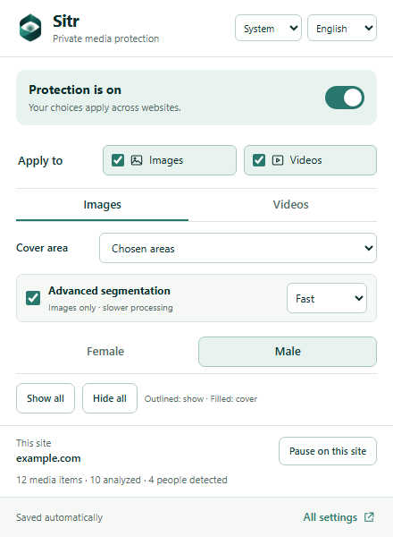
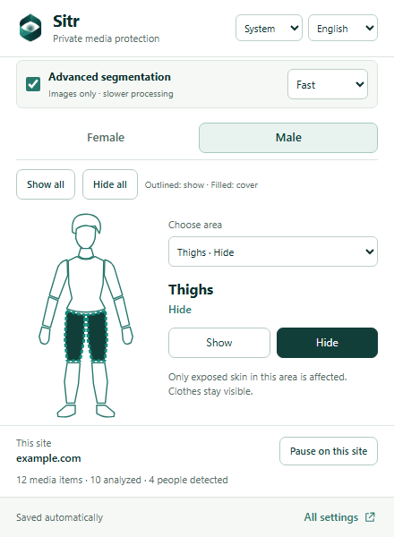
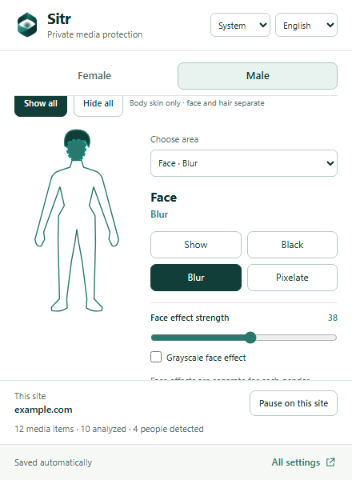
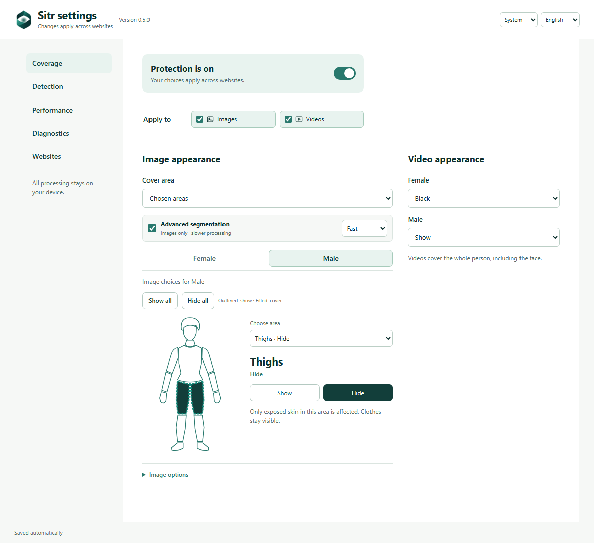
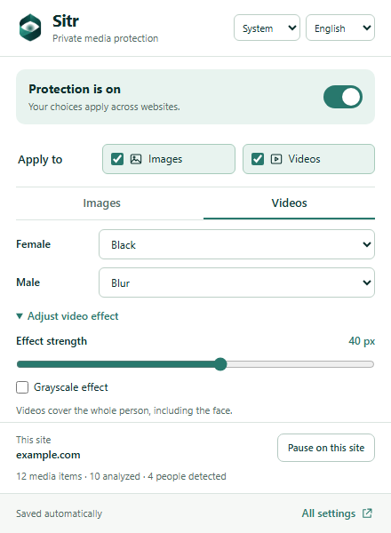

# Sitr user guide

Unpacked Chrome 148+ Manifest V3 extension for on-device censorship of supported images and sampled video. It combines YOLO26n-seg person masks, an optional detection-only fast video model, MediaPipe semantic masks, temporary tracking, face detection, and an appearance-based male/female classifier. Inference runs locally. No age result, face identity, or cross-session label is used.

This release detects and tracks up to 20 person instances per analyzed frame. A headless Chromium smoke fixture with ten people returned ten person tracks, ten face-to-person associations, and ten automatic labels. That fixture repeats two source people; it validates the multi-person plumbing and capacity, not accuracy on ten different people. Frontal and side-facing portrait classifier probes also passed, and one side-facing woman was labelled female by the full extension path. These checks do not establish natural-scene accuracy or performance on your machine. By default, a person with no usable face estimate stays censored; optional body models can estimate appearance from a person crop, but uncertain estimates remain unclassified.

YuNet 2026may draws face boxes and provides nose landmarks for face-to-person association. It runs on a 320×320 view of the 640×640 face capture; FastFace Large 128 then classifies crops from the original 640×640 capture. FastFace estimates visible male/female appearance; it does not determine a person's identity or gender, and may be wrong, especially for small, occluded, extreme-profile, or poorly lit faces. It ignores the model's age output. Both models and their licenses are pinned in `models/artifacts.json`. Their scores can be overconfident; the confidence controls are filters, not calibrated correctness guarantees.

Sitr cannot guarantee that no uncensored frame can appear. Browser measurements, failure cases, and limits are in [BENCHMARK.md](../BENCHMARK.md). Cold model startup and inference can be slow; video uses lower-rate analysis with motion-based mask movement between analyses.

## Install and run

YOLO prefers WebGPU with graph capture and a persistent GPU input buffer, falling back to the original WASM model when GPU setup fails. A worker failure or timeout also retries on WASM. MediaPipe semantic segmentation runs for every still image, including whole-body modes, to cover foreground regions missed by YOLO; video skips it. YuNet and FastFace retain WASM. No resolution, confidence threshold, weights or FP32 precision were reduced. The CPU thread setting controls WASM, not GPU parallelism. Native 20–30 ms inference is not guaranteed; see the measured results in BENCHMARK.md.

1. In PowerShell, open the project root and run `npm.cmd ci`.
2. Install a model ZIP matching this source revision with `npm.cmd run models -- --archive path/to/sitr-0.5.0-models.zip`, then run `npm.cmd run build`. Use the matching v0.5.0 bundle, which includes all fifteen models; source exports are documented in [models/README.md](../models/README.md).
3. In Chrome 148+, open `chrome://extensions`, enable **Developer mode**, choose **Load unpacked**, and select this folder's `dist` directory.
4. Open a page with images or readable video. Sitr starts with female-appearance filtering, automatic labeling, and the face classifier for both media types. The popup shows protection, media switches, Cover area, Advanced segmentation, and separate **Images** / **Videos** appearance tabs. **Pause on this site** adds the current domain to exceptions. Open **All settings** for a full-page view organized into Coverage, Detection, Performance, Diagnostics, and Websites. Website-list edits apply when you click **Save websites**.
5. After rebuilding, click **Reload** on the extension page and refresh the website tab. Confirm the version shown in **All settings** matches `manifest.json`.

The header includes **System / Light / Dark** theme choices and **English / العربية** language choices in both the popup and full settings. System follows your device theme. New users with an Arabic browser language start in Arabic; you can change languages at any time. Arabic includes a right-to-left layout, translated controls and help, and localized status messages. Theme and language are saved locally and synchronize between open views without restarting analysis or changing protection settings. The header uses the Sitr logo.

The Images editor has separate Female and Male tabs and a clickable person. Click an area, then choose Show or Hide; face also offers Black, Blur and Pixelate. To hide only male thighs, enable Advanced segmentation and choose Male → Show all, click the thighs, then Hide. Hair, face, neck and all other shown areas remain visible. Each gender has independent video Show/Black/Blur/Pixelate controls. The old global people filter and shared hair/face checkboxes are replaced by these policies. Old settings migrate when opening the editor. Labels still estimate appearance and can be wrong.

The visible Advanced segmentation switch above the gender tabs enables individual areas, with Fast (stride 16) or Quality (stride 8, slower with finer detail). Off mode shows one body-skin shape; Show all and Hide all above it leave hair and face choices independent. MediaPipe continues to detect exposed skin. Torso combines chest and belly; neck is estimated from head-labeled body skin. Unrecognized skin has its own area-menu choice. Model failure covers requested hidden skin conservatively, while fully shown people remain shown. Expansion respects shown areas and removes the old border around fully shown people. Unclassified people can Show or use the union of the two policies. Cover area is visible above the editor. Whole body includes clothing and keeps the face effect separate. Skin-exposure rules have been removed and saved rules are disabled. [Full area-editor behavior](BODY-REGIONS.md).

Whole-body images and videos each offer **Black**, **Normal blur**, and **Checkerboard blur** (pixelated mosaic), with separate intensity and grayscale controls for the two blur styles. Image faces have independent strength for each gender, shown directly below Blur or Pixelate; the optional grayscale face-effect setting is shared. Skin-and-hair image regions always stay black, even if a whole-body blur effect was previously selected. Effects are confined to the selected masks; if a page's media cannot be copied into the effect canvas, the mask remains black. Blur and mosaic can leave shapes recognizable, especially at low intensity.

**All settings → Detection** has separate **Image mask expansion** and **Video mask expansion** sliders from 0 to 24 analysis pixels. They default to 1 and 4 pixels respectively, matching the earlier fixed margins. An analysis pixel is a pixel in the selected YOLO input grid, so its size on screen depends on the media size and model resolution. Increasing a slider covers more nearby pixels; changing it redraws already-analyzed media without rerunning the models.

The **All settings → Detection → Playback** setting defaults to Smooth, which keeps the last analyzed mask visible while fresh analysis runs. Strict can black the video when an analysis becomes stale. **Person detector** defaults to YOLO silhouette; **Fast person boxes** uses a separate 256-pixel detection-only YOLO model and masks conservative rectangles around selected people. It runs more video analyses per second but can cover substantially more background. The video model choice reprocesses current media and leaves image mode unchanged. **Face/person matching** selects either stricter face-box overlap or simpler face-box center matching for silhouette mode. Fast boxes use a unique upper-body geometric match. Ambiguous matches remain unclassified.

**Site exceptions** accept hostnames or pasted HTTP(S) URLs. An entry covers that domain, its subdomains, and media inside embedded players on the page, even when the player is hosted elsewhere. Adding or removing an exception updates images and playing videos immediately and clears any old masks from the excepted site.

**Gender model** can be set independently for Images and Videos. **Face (current)** uses YuNet and FastFace. **Whole body · Intel** and **Whole body · Paddle** classify each detected person crop without needing a visible face; they skip face capture and face inference unless another enabled feature needs it. **Face, then Intel/Paddle if unavailable** tries the face model first and uses the chosen body model for a track without an accepted face estimate. Body modes work with either video person detector and with either image coverage mode. A body estimate still has to pass the confidence setting and video tracking evidence before it can exempt someone. Back-view results and speed limits are in [BENCHMARK.md](../BENCHMARK.md).

In either **Whole body** gender mode, FastFace never supplies a gender vote. Whole-body image masking may still run YuNet to locate the face opening, and the debug overlay labels those boxes as face locations rather than gender sources. The `data-local-media-censor-gender` diagnostic on media reports the selected `model`, `faceGenderAttempts`, and `bodyGenderAttempts` so this distinction can be checked directly. If both image and video select body-only modes, an already-loaded FastFace session is released.

Video updates fewer times per second than the displayed frames. Each tracked person gets an immediate classification check, then another check on the first analyzed frame at least one second later. New identities have their own timer. In face-first video modes, a missing face cannot replace a previous face result with a body-model guess; Intel/Paddle fallback can refresh a previous body-derived result, or start when a visible face cannot be classified confidently. Explicit body-only modes remain available. Opposite classification evidence immediately makes the old label unusable until a repeat check confirms the change. Scene cuts reset tracking, and substantially different appearances cannot inherit a label solely by occupying the same box. Face detection also runs for face diagnostics, image face effects, or whole-body image openings. The broader moving-person mask reduces exposed skin during limb motion but can obscure clothing and nearby pixels. Motion tracking and sparse detection still cannot guarantee that a fast new person or limb is covered on every frame. Smooth playback can show an old mask longer than Strict.

The **All settings → Diagnostics → Advanced AI thresholds** section exposes the YOLO person confidence threshold, face detector score and minimum face width, gender-estimate confidence (with a separate stricter cutoff for small faces), and face-to-person association coverage, winner margin, and center-mask confidence. Face/person mask coverage is the minimum fraction of the central face area owned by one YOLO person mask; it applies to both overlap and center matching. It does not govern body-only gender or fast person boxes, which do not use a YOLO person mask. The pixel sizes refer to the selected face-analysis frame. Lower confidence thresholds detect more candidates but can increase false detections and mistakes. Changing these controls reanalyzes current media and starts fresh temporary tracks.

The **ONNX CPU threads** control offers Auto and 1, 2, 4, 6, 8, 12, or 16 threads. Auto uses 1 thread on machines with up to four logical cores, 2 on five to eight, and 4 above eight. Changing the control restarts local inference and reanalyzes the page. More threads can reduce throughput when CPU inference competes with GPU segmentation, so compare settings on your own machine before increasing it. The thread control does not change models, input sizes, or detection thresholds.

Open **All settings → Performance → Model resolution** to set YOLO image and silhouette-video resolution independently (Auto, 256, 320, or 416 pixels), YuNet face-detection resolution (256, 320, or 416), and face-source detail (320, 416, 512, or 640). Fast video boxes always use 256 pixels. Auto YOLO sizes follow the performance preset; existing settings default to the same effective sizes as before. The face-source slider changes the image captured for detection and face crops, while the packaged FastFace model still receives 128×128 crops. The packaged MediaPipe semantic model runs for every still-image mode at 256×256. Higher values can improve small-detail detection but can increase latency and video blackouts; these controls change input resolution, not the model files or confidence thresholds.

Enable **Show AI debug outlines, face boxes, and gender estimates** in **All settings → Diagnostics** to draw person-instance mask contours and detected face boxes over media, with each current automatic appearance estimate and confidence. Unknown or unusable track labels are shown as unclassified. These visualizations are diagnostic and do not change censorship rules; they add some inference payload and drawing overhead.

Diagnostics include colored body regions, current per-gender policies, timing stages, backend and fallback status. See [body-region diagnostics](BODY-REGIONS.md).

## Screenshots



<p> </p>





## Test it

Run the checks from PowerShell:

```powershell
npm.cmd run typecheck
npm.cmd test
npm.cmd run build
npx.cmd playwright install chromium
$env:SMOKE_GENDER='1'
$env:SMOKE_QUICK='1'
node scripts/smoke.mjs
node scripts/popup-ux-check.mjs
node scripts/cross-origin-probe.mjs
node scripts/visibility-recovery-probe.mjs
node scripts/responsive-image-probe.mjs
node scripts/overlay-stacking-probe.mjs
node scripts/video-compatibility-probe.mjs
$env:PERF_THREADS='2'
$env:PERF_COUNT='12'
$env:PERF_REPETITIONS='2'
node scripts/perf.mjs
```

The gender smoke run builds a synthetic ten-person image and checks the reported person, face, association, and label counts. `SMOKE_QUICK=1` skips video playback to shorten this capacity check. Unset those variables to run the regular browser smoke, which also samples video:

```powershell
Remove-Item Env:SMOKE_GENDER -ErrorAction SilentlyContinue
Remove-Item Env:SMOKE_QUICK -ErrorAction SilentlyContinue
node scripts/smoke.mjs
```

Other optional checks: set `SMOKE_GRID=1` for viewport-only processing on a 24-image page; `SMOKE_SUSTAINED=1` and `SMOKE_LONG_VIDEO=1` for a ten-second video sample; or `SMOKE_SCROLL=1`, `SMOKE_AUTH=1`, `SMOKE_WEBP=1`, `SMOKE_LABEL=1`, `SMOKE_VIDEO_LABEL=1`, `SMOKE_STATUS=1`, `SMOKE_THREAD_SETTING=1`, `SMOKE_RESOLUTION=1`, `SMOKE_PROFILE=1`, or `SMOKE_PAUSE=1` for the named behavior. `SMOKE_THREAD_SETTING=1` and `SMOKE_RESOLUTION=1` require `SMOKE_STATUS=1`. `node scripts/face-probe.mjs` checks YuNet boxes, nose points, and classifier integration in packaged Chromium; `node scripts/gender-probe.mjs` checks frontal and side-facing portrait crops.

The smoke fixtures run in headless Chromium on local sample media. They do not test YouTube/social-site compatibility, ten unique people, extensive demographic or lighting variation, sustained hardware load, or zero-frame exposure. The included grid benchmark measures this computer's headless Chromium run, which may differ from regular Chrome and live websites.

For a sustained image-throughput check, set `PERF_COUNT=100` and `PERF_DURATION_MINUTES=15` before running `node scripts/perf.mjs`. Each completed 100-image batch prints its throughput and latency; the final line summarizes the run.

## Limits and privacy

CSS `background-image: url(...)` layers on HTML elements use the same image models and settings. Inline styles, stylesheet classes, multiple URL layers, and dynamic style changes are supported. Censored copies preserve background sizing, positioning, repetition, and foreground content; debug mode includes person outlines, face boxes, and labels. Backgrounds outside the viewport wait for analysis. Disabling image filtering restores the author's background styles. Manual click-to-label is currently available on regular images/videos only. Pseudo-element backgrounds, `image-set(...)`, and changes made solely through CSSOM APIs without a DOM/style event are not covered by background discovery.

Image/video discovery includes nested open and closed shadow roots, including roots attached after their host appears. Players inside those roots receive the same protection and masks as ordinary page media. For a cross-origin HTTP video loaded without `crossorigin`, an unreadable frame triggers one CORS check per source. If the CDN permits access, Sitr reloads the player with anonymous CORS, preserving its playback position, speed, and paused/playing state. This can briefly interrupt playback. If the check fails, the video stays black; blob/MediaSource streams and author-specified CORS settings are left alone. `node scripts/video-compatibility-probe.mjs` checks these paths with local browser fixtures; live Reddit and Pexels pages can require access challenges, so this is not a guarantee for every player on those sites.

Paused preview frames can wait for model startup without being discarded just because time elapsed. Transient engine or queue failures retry paused videos with a delay. Seeking, changing the source, or resuming playback retires the earlier frame so its result cannot replace the new one.

Google Meet participant videos and screen shares use the Videos settings. Visible tiles rotate through analysis with no more than two outstanding captures, so a large grid lowers the refresh rate per tile. Hidden and offscreen tiles do not reserve analysis turns. Static presentations are sampled even when no new video frame arrives. A changed live stream, replaced video track, or ended stream retires the tile's old masks and temporary labels. Stream capture does not reload the player or change its connection, camera, microphone, or outbound presentation. Coverage affects only what you see locally. Reload the extension and Meet tab after an update, enable Videos, and remove any Meet site exception. The fast person-box detector reduces analysis work. More tiles can produce older masks in Smooth or additional blackouts in Strict.

`node scripts/meet-video-probe.mjs` checks four genuine loopback WebRTC streams on a local fixture served at the Meet origin, including a shared presentation, stream/track replacement, ended/static streams, paused/hidden tiles, and site exceptions. It does not join an actual Google Meet meeting or validate every live Meet layout.

Animated images, DRM or video that remains unreadable, canvas players, restricted browser pages, and most picture-in-picture/native-fullscreen paths are unsupported. Unsupported acquisition or model failure keeps discovered media black. Sites that disallow blob images through CSP may hide the generated background instead of displaying it. Some warnings from ONNX Runtime or MediaPipe can be informational; repeated worker restarts or an `Analysis timed out` status are failures.

Frames, face crops, masks, tracks, and temporary labels stay in memory and are not sent to a server or persisted. Settings are stored locally. Cross-origin image acquisition may fetch the source image through extension permissions so it can be analyzed locally.

The current production/release checks are documented in [RELEASING.md](RELEASING.md). Historical measurements are described in BENCHMARK.md. Model URLs, hashes, and provenance are listed in [models/artifacts.json](../models/artifacts.json); license details are in [NOTICE.md](../NOTICE.md). Ultralytics software/weights have separate [licensing terms](https://www.ultralytics.com/license). Redistribute matching source and retain all licenses; see [SOURCE.md](../SOURCE.md).
